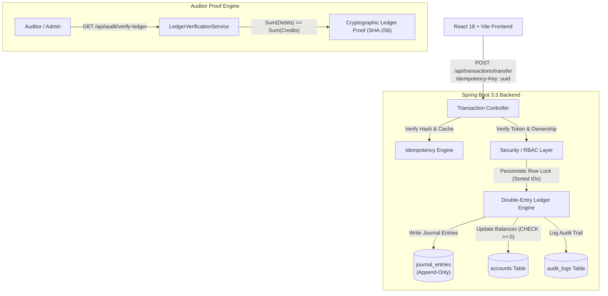

# LedgerLine — Money Movement with a Ledger You Can Prove

> **"Move money so the books always balance and the same request never pays twice."**  
> *Snovasys Fresher Hiring Challenge 2026 — VVIT*

---

## 🌐 Live Cloud Deployment Links
- **Live Frontend Application:** [https://ledger-line-eta.vercel.app/](https://ledger-line-eta.vercel.app/)
- **Live Backend API (Render):** [https://ledgerline-backend-wgun.onrender.com](https://ledgerline-backend-wgun.onrender.com)
- **Live Interactive Swagger Docs:** [https://ledgerline-backend-wgun.onrender.com/swagger-ui/index.html](https://ledgerline-backend-wgun.onrender.com/swagger-ui/index.html)
- **Health Check Endpoint:** [https://ledgerline-backend-wgun.onrender.com/api/health](https://ledgerline-backend-wgun.onrender.com/api/health)

---

## Architecture & System Design

LedgerLine is an enterprise-grade financial ledger engineered to eliminate unsafe money movement in distributed environments. It addresses race conditions, duplicate payments, unauthorized debits, and ledger discrepancies through strict mathematical invariants and database-level concurrency controls.



---

## 10 Core Requirements Matrix

| # | Requirement | Implementation Status | Evidence / Code Reference |
|---|---|---|---|
| **1** | **Authentication & Role-Based Access Control** | **COMPLETED** | JWT authentication with `ROLE_ADMIN`, `ROLE_ACCOUNT_HOLDER`, and `ROLE_AUDITOR` in `SecurityConfig.java`. |
| **2** | **Account Creation & Balance Management** | **COMPLETED** | Multi-account provisioning (Checking/Savings) in `AccountService.java` with initial zero balance. |
| **3** | **Deposits, Withdrawals, and Transfers** | **COMPLETED** | Complete transactional APIs in `LedgerService.java` handling money movement. |
| **4** | **Double-Entry Ledger & Conservation Checks** | **COMPLETED** | Every transaction writes balanced `DEBIT` and `CREDIT` entries in `journal_entries`; verified via `LedgerVerificationService.java`. |
| **5** | **Server-Side Prevention of Negative Balances** | **COMPLETED** | Dual layer: Code-level balance check throwing `InsufficientFundsException` + SQL `CHECK (balance >= 0.00)`. |
| **6** | **Idempotency (No Request Pays Twice)** | **COMPLETED** | Persistent `idempotency_records` table with SHA-256 payload hashing in `IdempotencyService.java`. |
| **7** | **Database Concurrency & Deadlock Protection** | **COMPLETED** | `@Lock(LockModeType.PESSIMISTIC_WRITE)` with ascending lock ordering (`Math.min` then `Math.max`). |
| **8** | **Append-Only Audit Trail & Statements** | **COMPLETED** | Immutable audit logs and account statements with running balances in `AuditService.java`. |
| **9** | **Account-Level Ownership & IDOR Protection** | **COMPLETED** | Object-level access control preventing unauthorized debits in `LedgerService.java`. |
| **10** | **Automated Concurrency & Security Tests** | **COMPLETED** | 5 comprehensive integration test suites in `src/test/java/com/snovasys/ledgerline/`. |

---

## Technology Stack

- **Backend:** Java 21, Spring Boot 3.3.4, Spring Data JPA, Spring Security 6, JJWT 0.12.6
- **Database:** PostgreSQL (with H2 in PostgreSQL mode for instant local testing)
- **Frontend:** React 18, Vite, Tailwind CSS, Lucide Icons
- **Documentation:** OpenAPI 3 / Swagger UI (`springdoc-openapi`)

---

## Quickstart Guide

### Prerequisites
- **Java 21**
- **Node.js 18+** & **npm**
- *(Optional)* PostgreSQL 15+ (H2 in-memory is enabled by default for instant local setup)

### 1. Run Backend
```bash
# Navigate to backend directory
cd backend

# Run with Maven Wrapper
./mvnw spring-boot:run
```
*The backend starts at `http://localhost:8080`.*  
*Swagger API Docs: `http://localhost:8080/swagger-ui.html`*  
*Health Check: `http://localhost:8080/api/health`*

### 2. Run Frontend
```bash
# Open second terminal and navigate to frontend directory
cd frontend

# Install dependencies and start Vite dev server
npm install
npm run dev
```
*The frontend opens at `http://localhost:5173`.*

---

## Seed Accounts & Personas (Pre-Configured)

| Persona / Name | Username | Password | Role | Description |
|---|---|---|---|---|
| **Alice Smith** | `alice` | `password123` | `ROLE_ACCOUNT_HOLDER` | Default account holder with Checking & Savings |
| **Bob Jones** | `bob` | `password123` | `ROLE_ACCOUNT_HOLDER` | Secondary account holder for transfer testing |
| **Compliance Auditor** | `auditor` | `auditor123` | `ROLE_AUDITOR` | Runs mathematical proof & checks logs |
| **System Admin** | `admin` | `admin123` | `ROLE_ADMIN` | Manages global accounts and system parameters |

*(Use the quick-switch persona buttons at the top of the frontend to switch roles instantly!)*

---

## Free Deployment Guide (Render + Vercel)

### 1. Database (Neon or Supabase - Free)
1. Create a free account at [Neon.tech](https://neon.tech) or [Supabase.com](https://supabase.com).
2. Create a database called `ledgerline_db` and copy the connection string.

### 2. Backend (Render.com - Free Web Service)
1. Create a new Web Service on [Render](https://render.com) linked to your GitHub repo (root directory: `backend`).
2. Build command: `mvn clean package -DskipTests`
3. Start command: `java -jar target/ledgerline-1.0.0-SNAPSHOT.jar`
4. Set Environment Variables:
   - `SPRING_PROFILES_ACTIVE`: `postgres`
   - `DB_URL`: `jdbc:postgresql://<neon-host>:5432/ledgerline_db`
   - `DB_USERNAME`: `<db-user>`
   - `DB_PASSWORD`: `<db-password>`

### 3. Frontend (Vercel or Netlify - Free)
1. Deploy `frontend` to [Vercel](https://vercel.com).
2. Configure `VITE_API_URL` pointing to your deployed Render backend.

---

## Running the Automated Test Suite

Run the full suite of security, concurrency, and mathematical proof tests:
```bash
cd backend
./mvnw test
```

### Key Tests Included:
1. `ConcurrencyAndRaceConditionTest.java`: Proves 10 simultaneous withdrawals on $100 cannot overdraw the account.
2. `BiDirectionalTransferDeadlockTest.java`: Proves simultaneous reverse transfers (`A->B` and `B->A`) execute without deadlocks.
3. `IdempotencyAndReplayAttackTest.java`: Proves duplicate requests with the same key never double-debit.
4. `AccessControlAndIdorTest.java`: Proves User B cannot debit or view User A's accounts.
5. `LedgerMathematicalProofTest.java`: Proves `Σ Debits == Σ Credits` and cryptographic checksum validity.
6. `NegativeAndZeroAmountPreventionTest.java`: Proves negative/zero financial operations are rejected.
